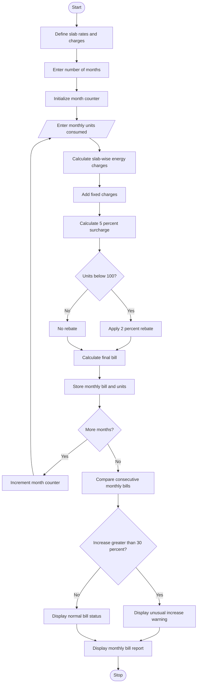

# Progressive Electricity Billing System Using Python

## 1. Problem Statement
 Progressive Electricity Billing: Calculate household bills using multiple consumption slabs, fixed charges, surcharges, and rebates, then compare bills across several months and identify unusual increases.

## 2. Algorithm

1. Start the program.
2. Define electricity tariff rates for different consumption slabs.
3. Get the number of months from the user.
4. For each month, enter the electricity units consumed.
5. Calculate the energy charges based on progressive slabs:
   - First 100 units: ₹2 per unit.
   - Next 100 units: ₹3 per unit.
   - Next 100 units: ₹5 per unit.
   - Above 300 units: ₹7 per unit.
6. Add fixed charges of ₹50.
7. Calculate a surcharge of 5% on the energy charges.
8. Apply a rebate of 2% if energy consumption is below 100 units.
9. Calculate the final bill.
10. Store the monthly bill and consumption details.
11. Compare the current month's bill with the previous month's bill.
12. If the bill increases by more than 30%, display an unusual increase warning.
13. Display the monthly bill details.
14. Stop the program.

## 3. Flowchart (Mermaid)

## 5. Sample Input

```
Enter number of months: 3

Month 1
Enter electricity units consumed: 80

Month 2
Enter electricity units consumed: 150

Month 3
Enter electricity units consumed: 300
```

## 6. Sample Output

```
Month 1
Energy Charge: Rs. 160.0
Fixed Charge: Rs. 50
Surcharge: Rs. 8.0
Rebate: Rs. 3.2
Total Bill: Rs. 214.8

Month 2
Energy Charge: Rs. 350.0
Fixed Charge: Rs. 50
Surcharge: Rs. 17.5
Rebate: Rs. 0
Total Bill: Rs. 417.5

Month 3
Energy Charge: Rs. 1000.0
Fixed Charge: Rs. 50
Surcharge: Rs. 50.0
Rebate: Rs. 0
Total Bill: Rs. 1100.0

========== MONTHLY BILL COMPARISON ==========

Month 1 - Bill: Rs. 214.8

Month 2 - Bill: Rs. 417.5
Bill Change: Rs. 202.7
Percentage Change: 94.36 %
WARNING: Unusual increase in electricity bill!

Month 3 - Bill: Rs. 1100.0
Bill Change: Rs. 682.5
Percentage Change: 163.47 %
WARNING: Unusual increase in electricity bill!

========== PROGRAM COMPLETED ==========
```

