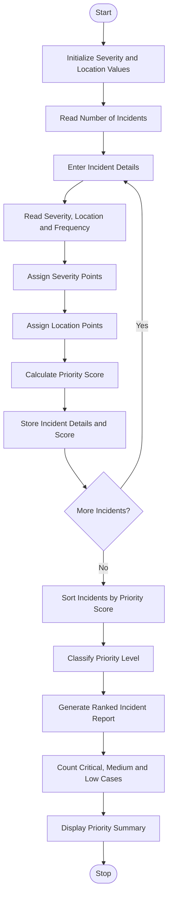

# Smart Campus Incident and Maintenance Prioritization Using Python

## 1. Problem Statement

Smart Campus Incident and Maintenance Prioritization: Classify hypothetical maintenance 
reports using severity, location, and reported frequency; rank cases using predefined rules and 
generate a priority summary. 
## 2. Algorithm

1. Start the program.
2. Initialize the priority values for severity and location.
3. Read the number of maintenance reports.
4. For each report, input:
   - Incident ID.
   - Incident description.
   - Severity level.
   - Location.
   - Reported frequency.
5. Assign severity points:
   - High = 5
   - Medium = 3
   - Low = 1
6. Assign location points:
   - Laboratory = 5
   - Classroom = 4
   - Library = 3
   - Corridor = 2
   - Other = 1
7. Calculate the priority score using:

&#x20;  Priority Score = (Severity × 5) + (Location × 3) + (Frequency × 2)

8. Store the calculated priority score.
9. Sort all incidents in descending order of priority score.
10. Classify each incident:
    - Score 40 or above: Critical Priority.
    - Score 25–39: Medium Priority.
    - Below 25: Low Priority.
11. Display the ranked incident report.
12. Count the incidents in each priority category.
13. Display the priority summary.
14. Stop the program.

## 3. Flowchart Using Mermaid


## 5. Sample Input

Assume four hypothetical maintenance incidents are reported on campus.

```
Enter number of maintenance reports: 4

Incident 1
Enter incident ID: INC101
Enter incident description: Electrical problem
Enter severity (High/Medium/Low): High
Enter location: Laboratory
Enter reported frequency: 5

Incident 2
Enter incident ID: INC102
Enter incident description: Broken classroom fan
Enter severity (High/Medium/Low): Medium
Enter location: Classroom
Enter reported frequency: 3

Incident 3
Enter incident ID: INC103
Enter incident description: Library light problem
Enter severity (High/Medium/Low): Low
Enter location: Library
Enter reported frequency: 2

Incident 4
Enter incident ID: INC104
Enter incident description: Water leakage
Enter severity (High/Medium/Low): High
Enter location: Corridor
Enter reported frequency: 4
```

## 6. Sample Output

```
========== CAMPUS MAINTENANCE REPORT ==========

Rank: 1
Incident ID: INC101
Description: Electrical problem
Severity: High
Location: Laboratory
Reported Frequency: 5
Priority Score: 50
Priority Level: Critical

Rank: 2
Incident ID: INC104
Description: Water leakage
Severity: High
Location: Corridor
Reported Frequency: 4
Priority Score: 45
Priority Level: Critical

Rank: 3
Incident ID: INC102
Description: Broken classroom fan
Severity: Medium
Location: Classroom
Reported Frequency: 3
Priority Score: 31
Priority Level: Medium

Rank: 4
Incident ID: INC103
Description: Library light problem
Severity: Low
Location: Library
Reported Frequency: 2
Priority Score: 17
Priority Level: Low

========== PRIORITY SUMMARY ==========

Total Valid Incidents: 4
Critical Priority Cases: 2
Medium Priority Cases: 1
Low Priority Cases: 1

Highest Priority Incident: INC101

========== ANALYSIS COMPLETED ==========
```

## 7. Explanation of the Program

1\. Severity Classification

```
severity_points = {    "High": 5,    "Medium": 3,    "Low": 1}
```

Assigns numerical values to incidents according to their severity.

2\. Location Classification

```
location_points = {    "Laboratory": 5,    "Classroom": 4,    "Library": 3,    "Corridor": 2,    "Other": 1}
```

Assigns higher importance to locations such as laboratories and classrooms.

3\. Priority Score Calculation

```
score = (    severity_points[severity] * 5    + location_points[location] * 3    + frequency * 2)
```

Calculates the priority score using severity, location, and reported frequency.

4\. Priority Classification

```
if score >= 40:    priority = "Critical"elif score >= 25:    priority = "Medium"else:    priority = "Low"
```

Classifies incidents into three priority categories based on their scores.

5\. Incident Ranking

```
incidents.sort(    key=lambda x: x["score"],    reverse=True)
```

Sorts incidents from highest to lowest priority score.

6\. Priority Summary

```
print("Critical Priority Cases:", critical_count)print("Medium Priority Cases:", medium_count)print("Low Priority Cases:", low_count)
```

Displays the total number of incidents in each priority category.

