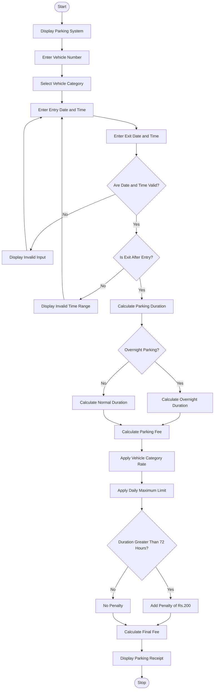

# Smart Parking Fee Management System Using Python

## 1. Problem Statement

Smart Parking Fee Management: Calculate charges from entry and exit times, vehicle categories, 
overnight parking, daily limits, and penalty conditions while validating time inputs.

## 2. Algorithm

1. Start the program.
2. Display the parking fee management system.
3. Get the vehicle number from the user.
4. Select the vehicle category:
   - Two-wheeler
   - Car
   - Bus
5. Get entry date and time.
6. Get exit date and time.
7. Validate the date and time inputs.
8. Check whether the exit time is later than the entry time.
9. Calculate the total parking duration in hours.
10. Check whether overnight parking is applicable.
11. Calculate the parking fee according to the vehicle category:
    - Two-wheeler: ₹10 per hour.
    - Car: ₹20 per hour.
    - Bus: ₹30 per hour.
12. Calculate the daily charge and apply the daily maximum limit.
13. If parking duration exceeds 24 hours, calculate the additional charges for each extra day.
14. Check penalty conditions. If parking exceeds 72 hours, add a penalty of ₹200.
15. Calculate the final amount.
16. Display the parking duration, basic fee, penalty, and total fee.
17. Stop the program.

## 3. Flowchart Using Mermaid


## 5. Sample Input

```

Enter Vehicle Number: AP39AB1234

Vehicle Categories:
1. Two-wheeler
2. Car
3. Bus

Select Vehicle Category (1-3): 2

Enter Entry Date and Time (YYYY-MM-DD HH:MM):
2026-10-29 20:00

Enter Exit Date and Time (YYYY-MM-DD HH:MM):
2026-10-30 08:00

```

## 6. Sample Output

```

===================================
 SMART PARKING FEE MANAGEMENT
===================================

========== PARKING RECEIPT ==========
Vehicle Number : AP39AB1234
Vehicle Type   : car
Entry Time     : 2026-10-29 20:00:00
Exit Time      : 2026-10-30 08:00:00
Parking Hours  : 12.0
Charged Hours  : 12
Overnight      : Yes
Parking Fee    : Rs. 200
Penalty        : Rs. 0
------------------------------------
TOTAL FEE      : Rs. 200
====================================

```
