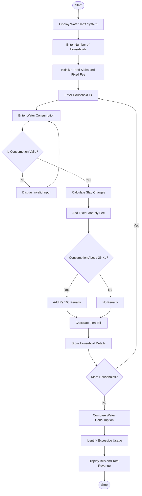

# Progressive Water Tariff Analysis Using Python

## 1. Problem Statement
 Progressive Water Tariff Analysis: Calculate bills for multiple households using consumption 
slabs, fixed fees, and penalties; compare consumption patterns and identify excessive usage. 
## 2. Algorithm

1. Start the program.
2. Display the Progressive Water Tariff Analysis System.
3. Enter the number of households.
4. Set the water tariff rates:
   - 0–10 KL: ₹5 per KL.
   - 11–20 KL: ₹10 per KL.
   - Above 20 KL: ₹15 per KL.
5. Set the fixed monthly fee as ₹50.
6. Set the excessive usage limit as 25 KL.
7. Set the excessive usage penalty as ₹100.
8. For each household:
   - Enter household ID.
   - Enter monthly water consumption.
   - Validate the consumption value.
9. Calculate the water bill using progressive slabs.
10. Add the fixed monthly fee.
11. Check whether consumption exceeds 25 KL.
12. If consumption exceeds 25 KL, add a penalty of ₹100.
13. Calculate the final bill.
14. Store the household consumption and bill details.
15. Compare consumption among all households.
16. Identify the household with the highest consumption.
17. Display households with excessive water usage.
18. Display individual bills and total revenue.
19. Stop the program.

## 3. Flowchart Using Mermaid


## 5. Sample Input

```

Enter number of households: 4

Household 1
Enter Household ID: H101
Enter Water Consumption (KL): 8

Household 2
Enter Household ID: H102
Enter Water Consumption (KL): 15

Household 3
Enter Household ID: H103
Enter Water Consumption (KL): 28

Household 4
Enter Household ID: H104
Enter Water Consumption (KL): 22

```

## 6. Sample Output

```

======================================
 PROGRESSIVE WATER TARIFF ANALYSIS
======================================

========== WATER BILL DETAILS ==========

Household ID : H101
Consumption  : 8.0 KL
Slab Charges : Rs. 40.0
Fixed Fee    : Rs. 50
Penalty      : Rs. 0
Total Bill   : Rs. 90.0

Household ID : H102
Consumption  : 15.0 KL
Slab Charges : Rs. 100.0
Fixed Fee    : Rs. 50
Penalty      : Rs. 0
Total Bill   : Rs. 150.0

Household ID : H103
Consumption  : 28.0 KL
Slab Charges : Rs. 220.0
Fixed Fee    : Rs. 50
Penalty      : Rs. 100
Total Bill   : Rs. 370.0

Household ID : H104
Consumption  : 22.0 KL
Slab Charges : Rs. 180.0
Fixed Fee    : Rs. 50
Penalty      : Rs. 0
Total Bill   : Rs. 230.0

========== CONSUMPTION ANALYSIS ==========

Highest Consumption:
H103 - 28.0 KL

Lowest Consumption:
H101 - 8.0 KL

Average Consumption: 18.25 KL

Excessive Water Usage Households:
H103 - 28.0 KL

======================================
Total Water Bill Revenue: Rs. 840.0
Number of Households: 4
======================================

```

