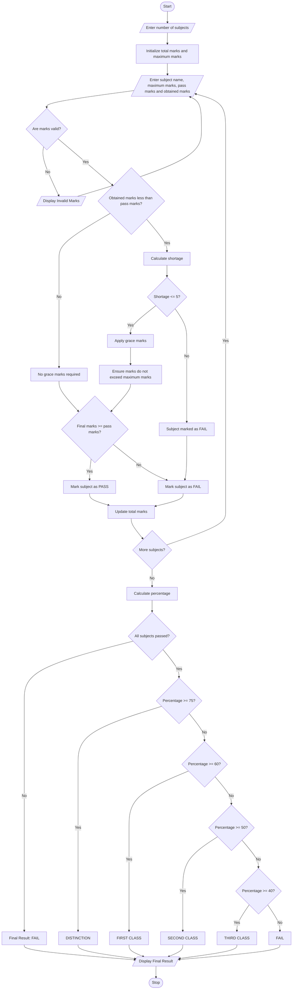

# Examination Result and Grace-Mark Validation Using Python

## 1. Problem Statement
Examination Result and Grace-Mark Validation: Process marks across multiple subjects, apply 
subject-wise pass criteria and a specified grace-mark policy, and generate final classifications 
without exceeding maximum marks.

## 2. Algorithm

1. Start.
2. Read the number of subjects.
3. Initialize total marks and total maximum marks to zero.
4. For each subject:
   - Read subject name.
   - Read maximum marks.
   - Read pass marks.
   - Read marks obtained.
5. Check whether obtained marks are greater than maximum marks or negative.
6. If marks are invalid, display an error.
7. If obtained marks are below pass marks:
   - Calculate the shortage of marks.
   - If shortage is less than or equal to 5, award grace marks.
   - Ensure final marks do not exceed maximum marks.
8. Check the pass condition for each subject.
9. Calculate total marks and percentage.
10. If all subjects are passed, determine classification:
    - 75% and above: DISTINCTION
    - 60% and above: FIRST CLASS
    - 50% and above: SECOND CLASS
    - 40% and above: THIRD CLASS
    - Otherwise: FAIL
11. Display subject-wise results, grace marks, total, percentage and final classification.
12. Stop.

## 3. Flowchart 



## 5. Sample Input

```
Enter number of subjects: 5

Subject 1
Enter subject name: Python
Enter maximum marks: 100
Enter pass marks: 40
Enter marks obtained: 75

Subject 2
Enter subject name: Java
Enter maximum marks: 100
Enter pass marks: 40
Enter marks obtained: 38

Subject 3
Enter subject name: DBMS
Enter maximum marks: 100
Enter pass marks: 40
Enter marks obtained: 65

Subject 4
Enter subject name: C
Enter maximum marks: 100
Enter pass marks: 40
Enter marks obtained: 42

Subject 5
Enter subject name: Maths
Enter maximum marks: 100
Enter pass marks: 40
Enter marks obtained: 80
```

## 6. Sample Output

```
========== EXAMINATION RESULT ==========

Subject  Obtained  Grace  Final  Result
Python      75       0      75    PASS
Java        38       2      40    PASS
DBMS        65       0      65    PASS
C           42       0      42    PASS
Maths       80       0      80    PASS

----------------------------------------
Total Marks: 302 / 500
Percentage: 60.40%
Final Classification: FIRST CLASS

========================================
```

