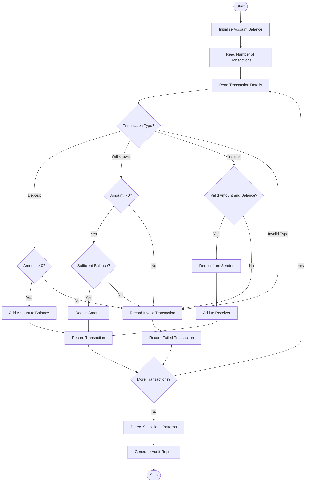

# Multi-Stage ATM Transaction Audit Using Python

## 1. Problem Statement

Multi-Stage ATM Transaction Audit: Process a sequence of deposits, withdrawals, and transfers 
in a simulated account, maintain balances, detect invalid operations, and report suspicious repeated 
patterns. 

The program should:

1. Maintain the account balance after every transaction.
2. Process deposits by adding money to the account.
3. Process withdrawals by deducting money from the account.
4. Process transfers by moving money from one account to another.
5. Detect invalid transactions, such as insufficient balance, negative amounts, or invalid transaction types.
6. Identify suspicious repeated transaction patterns, such as multiple withdrawals of the same amount.
7. Generate a final audit report containing successful transactions, failed transactions, suspicious activities, and the final account balance.

## 2. Algorithm

1. Start the program.
2. Initialize the account balance.
3. Read the number of transactions.
4. For each transaction:
   - Read the transaction type.
   - Read the transaction amount.
5. Check the transaction type.
6. If the transaction is a deposit:
   - Check whether the amount is positive.
   - Add the amount to the balance.
7. If the transaction is a withdrawal:
   - Check whether the amount is positive.
   - Check whether sufficient balance is available.
   - Deduct the amount if valid.
8. If the transaction is a transfer:
   - Check whether the amount is positive.
   - Check whether sufficient balance is available.
   - Deduct the amount from the sender and add it to the receiver.
9. Record successful and failed transactions.
10. Detect repeated withdrawals of the same amount.
11. Display the final account balance.
12. Display the transaction audit report.
13. Stop.

## 3. Flowchart Using Mermaid

## 5. Sample Input

Assume the initial account balance is Rs. 10,000 and the receiver's balance is Rs. 5,000.

```
Enter number of transactions: 6

Transaction 1
Enter transaction type: 1
Enter amount: 2000

Transaction 2
Enter transaction type: 2
Enter amount: 1000

Transaction 3
Enter transaction type: 2
Enter amount: 1000

Transaction 4
Enter transaction type: 2
Enter amount: 1000

Transaction 5
Enter transaction type: 3
Enter amount: 3000

Transaction 6
Enter transaction type: 2
Enter amount: 20000
```

## 6. Sample Output

```
Deposit successful!

Withdrawal successful!

Withdrawal successful!

Withdrawal successful!

Transfer successful!

Insufficient balance!

========== ATM AUDIT REPORT ==========

Final Account Balance: Rs. 6000.0
Receiver Account Balance: Rs. 8000.0

Successful Transactions:
Deposit: Rs.2000.0
Withdrawal: Rs.1000.0
Withdrawal: Rs.1000.0
Withdrawal: Rs.1000.0
Transfer: Rs.3000.0

Failed Transactions:
Withdrawal failed

Suspicious Activities:
Repeated withdrawal detected: Rs. 1000.0

Total Successful Transactions: 5
Total Failed Transactions: 1

========== AUDIT COMPLETED ==========
```

## 7. Explanation of Output

| Operation       | Amount     | Account balance |
| --------------- | ---------- | --------------- |
| Initial balance | —          | Rs. 10,000      |
| Deposit         | Rs. 2,000  | Rs. 12,000      |
| Withdrawal      | Rs. 1,000  | Rs. 11,000      |
| Withdrawal      | Rs. 1,000  | Rs. 10,000      |
| Withdrawal      | Rs. 1,000  | Rs. 9,000       |
| Transfer        | Rs. 3,000  | Rs. 6,000       |
| Withdrawal      | Rs. 20,000 | Failed          |

Suspicious activity: Three withdrawals of Rs. 1,000 were detected because the same withdrawal amount occurred three times.

Final account balance: Rs. 6,000.

