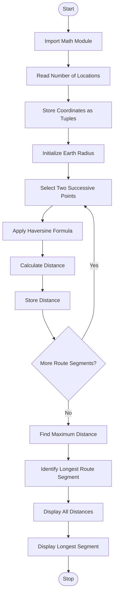

# Tuple-Based Route Distance Analysis Using Python

## 1. Problem Statement
Tuple-Based Route Distance Analysis: Store geographical coordinates as tuples, calculate 
distances between successive points using a supplied formula, and identify the longest route 
segment.
## 2. Algorithm

1. Start the program.
2. Import the `math` module.
3. Read the number of geographical locations.
4. Store the latitude and longitude of each location as a tuple.
5. Initialize the Earth's radius as 6371 km.
6. Calculate the distance between each pair of successive points using the Haversine formula.
7. Store the calculated distances in a list.
8. Find the maximum distance using the `max()` function.
9. Identify the corresponding route segment.
10. Display all segment distances.
11. Display the longest route segment and its distance.
12. Stop the program.

## 3. Flowchart Using Mermaid


## 5. Sample Input

```
Enter number of locations: 4

Location 1
Enter latitude: 13.0827
Enter longitude: 80.2707

Location 2
Enter latitude: 12.9716
Enter longitude: 77.5946

Location 3
Enter latitude: 17.3850
Enter longitude: 78.4867

Location 4
Enter latitude: 19.0760
Enter longitude: 72.8777
```

## 6. Sample Output

```
========== ROUTE DISTANCE ANALYSIS ==========

Segment 1 : 290.04 km
Segment 2 : 504.0 km
Segment 3 : 623.0 km

Longest Route Segment:
From Location 3 to Location 4

Distance: 623.0 km

========== ANALYSIS COMPLETED ==========
```

Note: Distances are approximate and may vary slightly due to rounding.

## 7. Explanation of the Program

1\. Tuple Storage

```
locations.append((latitude, longitude))
```

Each geographical location is stored as a tuple containing latitude and longitude.

2\. Distance Calculation

The Haversine formula calculates the distance between two geographical coordinates on the Earth's surface.

\\[ a=\sin^2\left(\frac{\Delta\phi}{2}\right) +\cos(\phi_1)\cos(\phi_2) \sin^2\left(\frac{\Delta\lambda}{2}\right) \\]

\\[ d=2R\arctan2(\sqrt{a},\sqrt{1-a}) \\]

Where:

- \\(R\\) = Earth's radius (6371 km).
- \\(\phi_1,\phi_2\\) = Latitudes in radians.
- \\(\lambda_1,\lambda_2\\) = Longitudes in radians.
- \\(d\\) = Distance between two points.

3\. Finding the Longest Segment

```
max_distance = max(distances)max_index = distances.index(max_distance)
```

The `max()` function identifies the longest distance, and `index()` identifies its position in the route.

