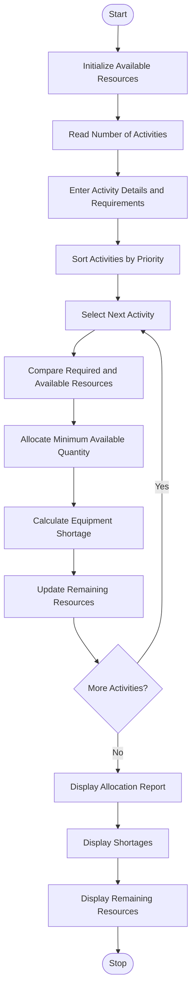

# Campus Resource Allocation Under Constraints Using Python

## 1. Problem StatementCampus Resource Allocation Under Constraints: Compare equipment requirements with 
available resources across multiple activities, calculate shortages, and produce a feasible allocation 
using a specified priority order


## 2. Algorithm

1. Start the program.
2. Initialize the available campus resources.
3. Read the number of activities.
4. For each activity, input:
   - Activity name.
   - Priority number.
   - Required quantity of each equipment.
5. Sort activities according to priority (priority 1 has the highest priority).
6. Initialize allocated resources to zero.
7. Process activities one by one according to priority.
8. For each activity:
   - Compare required equipment with available equipment.
   - Allocate the minimum of required and available quantities.
   - Calculate the shortage.
   - Update the remaining resources.
9. Repeat until all activities are processed.
10. Display the resource allocation report.
11. Display shortages for each activity.
12. Display the remaining available resources.
13. Stop the program.

## 3. Flowchart Using Mermaid


## 5. Sample Input

Assume the campus has the following available resources:

- Projector: 5
- Laptop: 10
- Microphone: 6

Three activities require these resources.

```
Enter number of activities: 3

Activity 1
Enter activity name: Seminar
Enter priority (1 = Highest): 1
Enter equipment requirements:
Enter Projector required: 3
Enter Laptop required: 5
Enter Microphone required: 2

Activity 2
Enter activity name: Workshop
Enter priority (1 = Highest): 2
Enter equipment requirements:
Enter Projector required: 3
Enter Laptop required: 4
Enter Microphone required: 3

Activity 3
Enter activity name: Cultural Event
Enter priority (1 = Highest): 3
Enter equipment requirements:
Enter Projector required: 2
Enter Laptop required: 3
Enter Microphone required: 4
```

## 6. Sample Output

```
========== CAMPUS RESOURCE ALLOCATION REPORT ==========

Activity: Seminar
Priority: 1

Allocated Resources:
Projector : 3
Laptop : 5
Microphone : 2

Shortage:
Projector : 0
Laptop : 0
Microphone : 0

Activity: Workshop
Priority: 2

Allocated Resources:
Projector : 2
Laptop : 4
Microphone : 3

Shortage:
Projector : 1
Laptop : 0
Microphone : 0

Activity: Cultural Event
Priority: 3

Allocated Resources:
Projector : 0
Laptop : 1
Microphone : 1

Shortage:
Projector : 2
Laptop : 2
Microphone : 3

========== REMAINING RESOURCES ==========

Projector : 0
Laptop : 0
Microphone : 0

========== ALLOCATION COMPLETED ==========
```

## 7. Explanation of the Program

1\. Resource Initialization

```
available = {    "Projector": 5,    "Laptop": 10,    "Microphone": 6}
```

A dictionary stores the total available quantity of each equipment.

2\. Priority-Based Sorting

```
activities.sort(key=lambda x: x["priority"])
```

Activities are arranged according to priority. Priority 1 receives resources first.

3\. Resource Allocation

```
allocated = min(required, available[equipment])
```

The `min()` function ensures that the allocated quantity never exceeds the available resources.

4\. Shortage Calculation

```
shortage_quantity = required - allocated
```

The shortage is calculated by subtracting the allocated quantity from the required quantity.

5\. Updating Available Resources

```
available[equipment] -= allocated
```

After every allocation, the remaining resources are updated.

