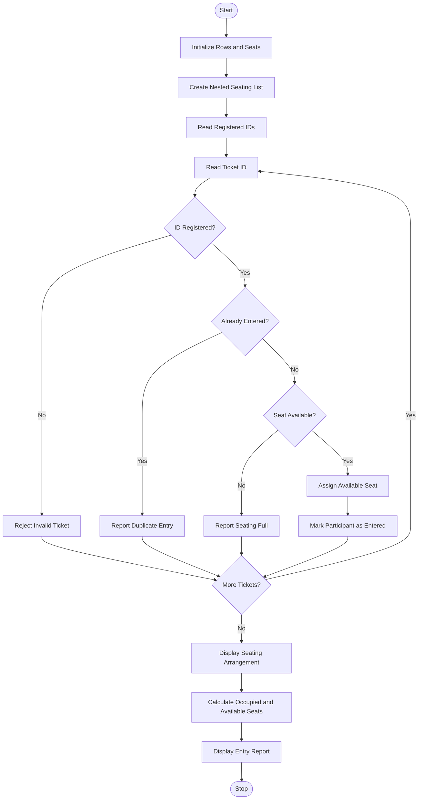

# Campus Event Seating and Entry Validation Using Python

## 1. Problem Statement

Campus Event Seating and Entry Validation: Generate seating assignments from nested lists, 
validate tickets against registration identifiers, detect duplicate entries, and report available seating 
capacity.

## 2. Algorithm

1. Start the program.
2. Initialize the number of rows and seats per row.
3. Create a nested list representing the seating arrangement.
4. Read the registration IDs of participants.
5. Store the registered IDs in a list.
6. Initialize an empty list to track entered participants.
7. Read the ticket IDs presented at the entrance.
8. For each ticket:
   - Check whether the ID exists in the registration list.
   - If the ID is invalid, reject entry.
   - If the ID has already entered, report a duplicate entry.
   - Otherwise, assign an available seat.
   - Mark the participant as entered.
9. Display the seating arrangement.
10. Calculate occupied and available seats.
11. Display valid entries, invalid entries, and duplicate entries.
12. Stop the program.

## 3. Flowchart Using Mermaid

## 5. Sample Input

```
Enter number of rows: 2
Enter seats per row: 3

Enter number of registered participants: 4

Enter registration ID: REG101
Enter registration ID: REG102
Enter registration ID: REG103
Enter registration ID: REG104

Enter number of ticket attempts: 6

Enter ticket registration ID: REG101

Enter ticket registration ID: REG102

Enter ticket registration ID: REG101

Enter ticket registration ID: REG105

Enter ticket registration ID: REG103

Enter ticket registration ID: REG104
```

## 6. Sample Output

```
Entry successful!
Assigned Seat: Row 1 Seat 1

Entry successful!
Assigned Seat: Row 1 Seat 2

Duplicate entry detected!

Invalid ticket! Entry rejected.

Entry successful!
Assigned Seat: Row 1 Seat 3

Entry successful!
Assigned Seat: Row 2 Seat 1

========== SEATING ARRANGEMENT ==========

Row 1 : ['REG101', 'REG102', 'REG103']
Row 2 : ['REG104', None, None]

========== EVENT ENTRY REPORT ==========

Total Seating Capacity: 6
Occupied Seats: 4
Available Seats: 2

Valid Entries: ['REG101', 'REG102', 'REG103', 'REG104']

Invalid Entries: ['REG105']

Duplicate Entries: ['REG101']

========== EVENT AUDIT COMPLETED ==========
```

## 7. Explanation of the Program

1\. Nested List Creation

```
seating = [[None for j in range(seats_per_row)]           for i in range(rows)]
```

A nested list represents the seating arrangement. Each inner list represents one row, and `None` indicates an empty seat.

2\. Ticket Validation

```
if ticket_id not in registered_ids:    print("Invalid ticket! Entry rejected.")
```

Checks whether the ticket registration ID exists in the registered participant list.

3\. Duplicate Entry Detection

```
elif ticket_id in entered_ids:    print("Duplicate entry detected!")
```

Checks whether a participant has already entered the event.

4\. Seat Assignment

```
if seating[r][s] is None:    seating[r][s] = ticket_id
```

Finds the first available seat and assigns the participant's registration ID.

5\. Available Seating Capacity

```
total_seats = rows * seats_per_rowoccupied_seats = len(valid_entries)available_seats = total_seats - occupied_seats
```

Calculates the total seating capacity, occupied seats, and remaining available seats.

