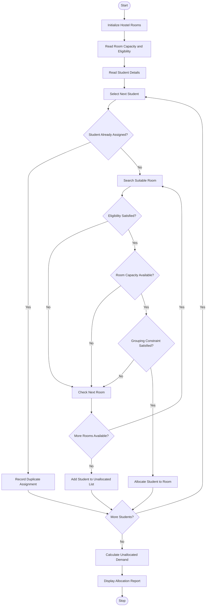

# University Hostel Room Allocation Using Python

## 1. Problem Statement

University Hostel Room Allocation: Allocate students to rooms according to capacity, room 
eligibility, and specified grouping constraints; detect duplicate assignments and calculate 
unallocated demand.
## 2. Algorithm

1. Start the program.
2. Initialize hostel room details.
3. Read the number of rooms.
4. Enter room number, capacity, and eligibility.
5. Read the number of students.
6. Enter student ID, gender, and group.
7. Create an empty allocation list for every room.
8. Select a student from the student list.
9. Check whether the student ID is already assigned.
10. Check room eligibility.
11. Check whether the room has sufficient capacity.
12. Check whether the grouping constraint is satisfied.
13. If all conditions are satisfied, allocate the student.
14. Otherwise, search for another suitable room.
15. If no suitable room is available, add the student to the unallocated list.
16. Repeat until all students are processed.
17. Calculate total allocated and unallocated students.
18. Display the room allocation details.
19. Display duplicate assignments and unallocated demand.
20. Stop the program.

## 3. Flowchart Using Mermaid



## 5. Sample Input

The following example uses four hostel rooms and ten students.

Hostel room details:

| Room Number | Capacity | Eligibility |
| ----------- | -------- | ----------- |
| R101        | 2        | Boys        |
| R102        | 3        | Girls       |
| R103        | 2        | Boys        |
| R104        | 3        | Girls       |

Student details:

| Student ID | Gender | Group  |
| ---------- | ------ | ------ |
| S101       | Boys   | GroupA |
| S102       | Boys   | GroupA |
| S103       | Girls  | GroupB |
| S104       | Girls  | GroupB |
| S105       | Boys   | GroupC |
| S106       | Girls  | GroupD |
| S107       | Boys   | GroupC |
| S108       | Girls  | GroupD |
| S109       | Boys   | GroupE |
| S110       | Girls  | GroupF |

Note: The above details are predefined in the source code.

## 6. Sample Output

```
S101 allocated to R101
S102 allocated to R101
S103 allocated to R102
S104 allocated to R102
S105 allocated to R103
S106 allocated to R104
S107 allocated to R103
S108 allocated to R104

========== HOSTEL ALLOCATION REPORT ==========

Room Number: R101
Eligibility: Boys
Capacity: 2
Allocated Students:
S101 - GroupA
S102 - GroupA
Occupied Seats: 2
Available Seats: 0

Room Number: R102
Eligibility: Girls
Capacity: 3
Allocated Students:
S103 - GroupB
S104 - GroupB
Occupied Seats: 2
Available Seats: 1

Room Number: R103
Eligibility: Boys
Capacity: 2
Allocated Students:
S105 - GroupC
S107 - GroupC
Occupied Seats: 2
Available Seats: 0

Room Number: R104
Eligibility: Girls
Capacity: 3
Allocated Students:
S106 - GroupD
S108 - GroupD
Occupied Seats: 2
Available Seats: 1

========== FINAL ALLOCATION SUMMARY ==========

Total Hostel Capacity: 10
Total Students: 10
Total Allocated: 8
Unallocated Demand: 2

Unallocated Students: ['S109', 'S110']

Duplicate Assignments: []

========== ALLOCATION COMPLETED ==========
```

## 7. Explanation of the Program

1\. Room Details Using Dictionaries

```
{"room": "R101", "capacity": 2, "gender": "Boys", "students": []}
```

Stores the room number, room capacity, eligibility, and allocated students.

2\. Student Details Using Tuples

```
("S101", "Boys", "GroupA")
```

Stores the student ID, gender, and group.

3\. Eligibility Checking

```
if room["gender"] != gender:    continue
```

Checks whether the student is eligible for the room.

4\. Capacity Checking

```
if len(room["students"]) >= room["capacity"]:    continue
```

Ensures that the room does not exceed its maximum capacity.

5\. Grouping Constraint

```
if room["students"]:    existing_group = room["students"][0][1]    if existing_group != group:        continue
```

Ensures that students belonging to different groups are not allocated to the same room.

6\. Duplicate Assignment Detection

```
if student_id in assigned_students:    duplicate_assignments.append(student_id)
```

Identifies students who have already received a room assignment.

7\. Unallocated Demand Calculation

```
unallocated_demand = len(unallocated_students)
```

Calculates the number of students who could not be allocated to any suitable room.


